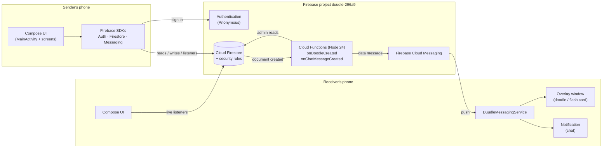
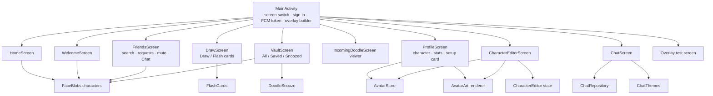
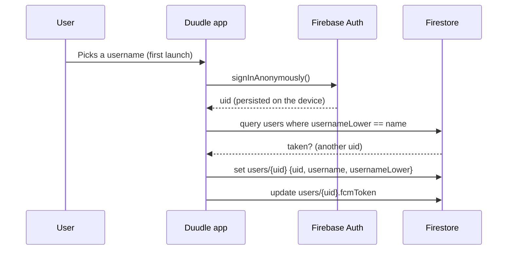
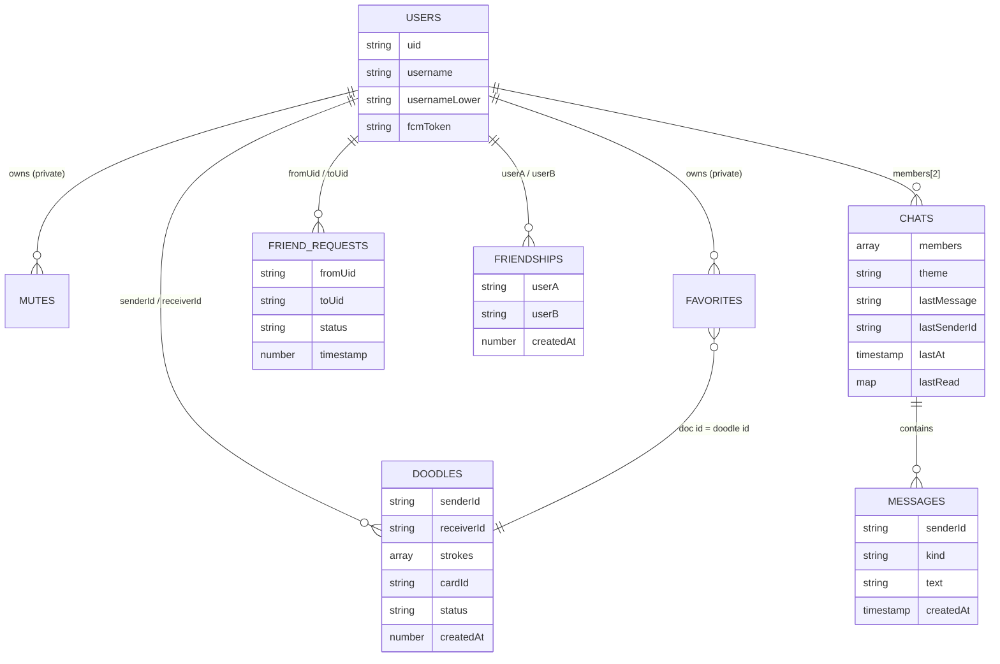
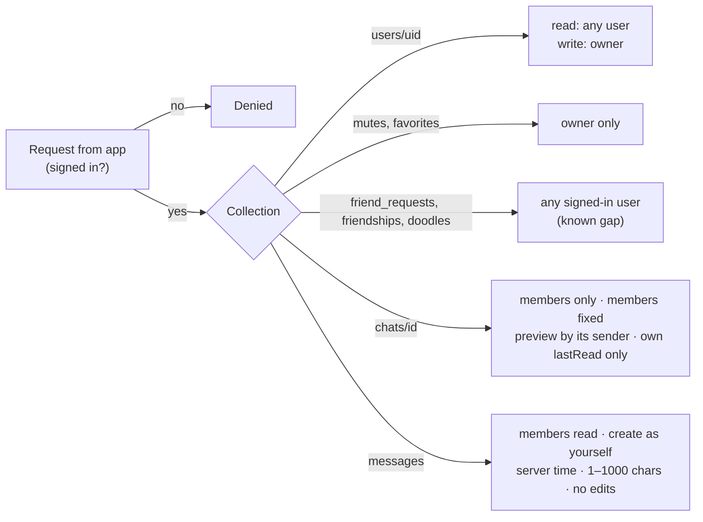
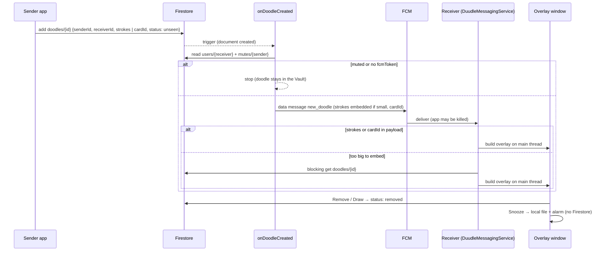
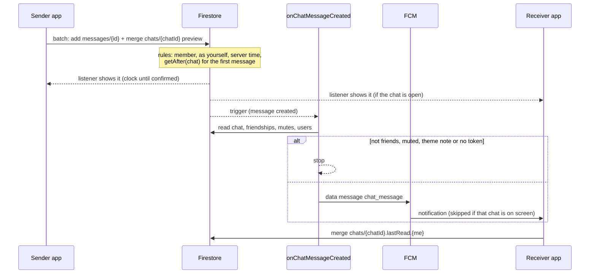
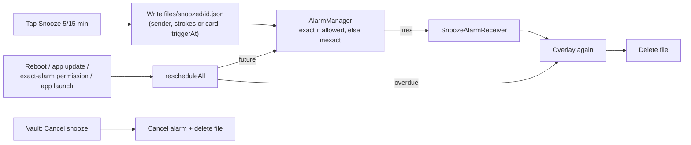
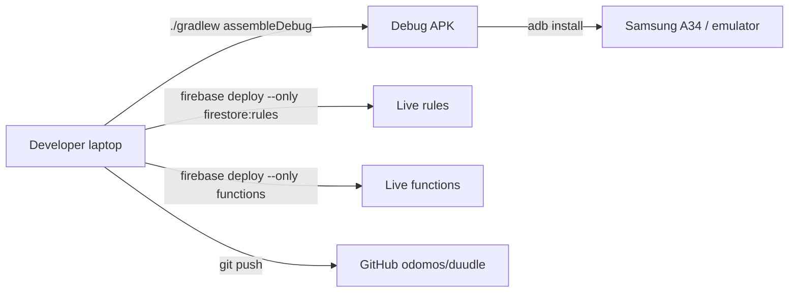

# Duudle architecture

How Duudle is put together: the Android frontend, the Firebase backend, the database, the
"APIs" between them, authentication, the major components, and how information moves
through the system. Field-by-field data shapes and step-by-step feature behaviour are in
[`README.md`](README.md); this document is about structure and flow.

---

## 1. System overview

Duudle is a **serverless mobile app**. There is no custom application server: the Android
client talks straight to Firebase, and a small set of Cloud Functions reacts to database
writes to send push messages.

| Layer | Technology | Responsibility |
|---|---|---|
| Frontend | Kotlin, Jetpack Compose, Android framework | All UI, drawing, overlays, notifications, local storage, alarms |
| Authentication | Firebase Anonymous Auth | Gives every install a stable `uid` |
| Database | Cloud Firestore (+ `firestore.rules`) | Users, friendships, doodles, chats; enforces access |
| Backend logic | Cloud Functions, 2nd gen, Node.js 24, `us-central1` | Turns new doodles and chat messages into pushes |
| Messaging | Firebase Cloud Messaging | Delivers data messages to the receiver, even with the app killed |
| On-device | SharedPreferences, app files, `AlarmManager` | Username cache, profile character, snoozed doodles |

---

## 2. Frontend (Android client)

### 2.1 Structure
- **One activity:** `MainActivity` hosts every screen. Navigation is a plain
  `enum class Screen { WELCOME, HOME, DRAW, FRIENDS, VAULT, OVERLAY_DEBUG, VIEW_DOODLE, PROFILE,
  EDIT_CHARACTER, CHAT }` held in `rememberSaveable`; a `when` picks the screen. There is no
  Navigation library and no back stack: a `BackHandler` routes system back (to Home, or
  Profile from the editor, or Friends from a chat), and screens that need to intercept back
  (Vault detail, the character editor's unsaved-changes dialog) register their own.
- **No ViewModels.** State lives in composables (`remember` / `rememberSaveable`) and in
  `MainActivity` for app-wide values (current screen, recipient, incoming doodles). Firestore
  snapshot listeners are attached in `DisposableEffect` blocks and removed when the screen
  leaves composition.
- **Pure logic is kept out of Compose** so it can be unit tested on the JVM: stroke
  simplification and zoom maths, the avatar format (`Avatar.kt`), the editor state machine
  (`CharacterEditor.kt`), chat helpers (`Chat.kt`), flash card lookup (`FlashCards.kt`) and
  snooze timing (`DoodleSnooze.kt`).

### 2.2 Screens and major components

| Component | File(s) | Role |
|---|---|---|
| App shell | `MainActivity.kt` | Screen switching, sign-in and username save, FCM token save, notification-tap handling, **overlay window builder** (`showRealDoodleOverlay`) |
| Drawing | `DrawScreen.kt` | Square canvas with normalized strokes, zoom, recipient picker, doodle and flash card sending |
| Friends | `FriendsScreen.kt` | User search, friend requests, friend list with mute, Send doodle and Chat |
| Vault | `VaultScreen.kt`, `IncomingDoodleScreen.kt` | History of sent/received items, favourites, snoozed items, detail view |
| Profile | `ProfileScreen.kt`, `Avatar*.kt`, `CharacterEditor*.kt` | Vector character (drawn in code), full-screen editor with draft/saved state, stats |
| Chat | `Chat.kt`, `ChatRepository.kt`, `ChatScreen.kt`, `ChatThemes.kt` | Real-time 1:1 chat, all Firestore access in the repository |
| Flash cards | `FlashCards.kt` | Catalogue of bundled images and the shared `DoodleOrCard` renderer |
| Snooze | `DoodleSnooze.kt` | Snooze files, alarms, re-arming, cancel |
| Push handling | `DuudleMessagingService.kt` | FCM entry point; stroke JSON parsing |
| Design system | `DuudleComponents.kt`, `ui/theme/*`, `BottomNav.kt`, `FaceBlobs.kt` | Shared header, tabs, pills, colours, bottom bar, animated characters |

### 2.3 Platform integrations
| Android API | Used for |
|---|---|
| `WindowManager` + `TYPE_APPLICATION_OVERLAY` | Doodle and flash card pop-ups over other apps (needs *Display over other apps*); always created on the main thread |
| `FirebaseMessagingService` | Receiving pushes when the app is in any state |
| `NotificationManager` (channel *Chat messages*) | Chat notifications, private on the lock screen |
| `AlarmManager` + `BroadcastReceiver`s | Snooze: `SnoozeAlarmReceiver` fires, `SnoozeRescheduleReceiver` re-arms after reboot, app update or permission change |
| `SharedPreferences` (`duudle_prefs`), app files | Local-only data (section 4.3) |

---

## 3. Authentication

- **Anonymous accounts only.** The `uid` is the user's identity everywhere: document ids,
  sender fields, rule checks. It is persisted by the Firebase SDK on the device.
- **One device, one account.** There's no email, password or account recovery; uninstalling
  or clearing data starts a fresh account. `android:allowBackup="false"` prevents restoring a
  stale username onto a new uid.
- **Every Firestore request is authenticated:** all rules start with `request.auth != null`,
  and ownership checks compare `request.auth.uid` with document fields or ids.
- **The FCM token** is the device's push address, stored on `users/{uid}` and refreshed in
  `DuudleMessagingService.onNewToken`.

---

## 4. Database

### 4.1 Collections

Design decisions:

- **Doodles and flash cards share one collection.** A card is a doodle with `cardId` and no
  strokes, so mute, Vault, snooze, stats and replies need no second code path.
- **Strokes are vector data, normalized to 0–1** of a **square** canvas, simplified and rounded
  before saving, so a doodle renders identically on any screen and usually fits in a push.
- **Deterministic chat ids:** `chats/{uidLow_uidHigh}`. Both people always address the same
  document, and the rules can check membership from the id itself.
- **Private data is a subcollection, not a field.** Mutes and favourites live under
  `users/{uid}/…` with owner-only rules, so a friend can't tell they were muted or what was
  saved.
- **Queries avoid composite indexes:** equality filters, a single-field prefix range for
  search, `array-contains` without `orderBy` for chat lists, and `count()` aggregations for
  stats.

### 4.2 Access control (security rules)

Rules are versioned in [`firestore.rules`](firestore.rules) and deployed with the Firebase CLI.
Because pushes are sent by functions with admin rights, the functions repeat the
trust-sensitive checks themselves (mute, chat friendship, server-side username).

### 4.3 On-device storage
| Data | Store | Reason |
|---|---|---|
| Username cache | SharedPreferences `duudle_prefs` | Decide Welcome vs Home instantly |
| Profile character | `duudle_prefs` key `avatar_v1_<uid>` (versioned string) | Owner-only; additive format so old saves keep loading |
| Snoozed doodles | `files/snoozed/<doodleId>.json` + an alarm | Must re-show offline and with the app killed |

---

## 5. APIs and interfaces

Duudle has no REST API of its own. The interfaces between parts are:

| Interface | Between | Shape |
|---|---|---|
| **Firestore SDK** | App ↔ Firestore | Document reads/writes, batched writes (chat), snapshot listeners (live data), `count()` aggregations, offline cache |
| **Firestore triggers** | Firestore → Cloud Functions | `onDocumentCreated("doodles/{id}")`, `onDocumentCreated("chats/{chatId}/messages/{id}")` |
| **Firebase Admin SDK** | Functions ↔ Firestore / FCM | Admin reads (users, mutes, friendships, chats) and `getMessaging().send()` |
| **FCM data messages** | FCM → app | `type: "new_doodle"` and `type: "chat_message"` payloads, high priority |
| **Android intents** | Notification / overlay → `MainActivity` | `open_chat_uid` (open a chat), `reply_to_uid` / `reply_to_username` (draw a reply); uids are validated because the activity is exported |

### Push payload contract
| `type` | Sent by | Fields | Receiver action |
|---|---|---|---|
| `new_doodle` | `onDoodleCreated` | `doodleId`, `senderId`, `senderUsername`, `strokes` (if ≤ 3600 bytes), `cardId` (cards) | Show the overlay; if strokes are missing, fetch `doodles/{doodleId}` |
| `chat_message` | `onChatMessageCreated` | `chatId`, `senderId`, `senderUsername` (≤ 32), `text` (≤ 200) | Show a notification unless that chat is open |

These payload fields, the stroke format and the card ids are contracts between deployed
functions and installed apps; change them only additively.

---

## 6. How information moves

### 6.1 Doodle or flash card: from one phone to another's screen

### 6.2 Chat message

### 6.3 Snooze (entirely on the device)

### 6.4 Live screens
Home, Friends, Vault and Chat don't poll. They attach Firestore **snapshot listeners**, so a
write by either user shows up on both phones within moments, and Firestore's offline cache
keeps the last data visible without a connection.

| Screen | Listens to |
|---|---|
| Home | `doodles` where `receiverId == me` and `status == "unseen"` |
| Friends | `friendships` (both sides), `friend_requests` to me, my `mutes`, my `chats` (unread dots) |
| Vault | `doodles` sent and received, my `favorites` |
| Chat | newest 50 `messages`, the `chats/{id}` doc |

---

## 7. Reliability and constraints

| Concern | How it's handled |
|---|---|
| App killed when a push arrives | Data messages always reach `onMessageReceived`; the big-doodle fallback blocks on the fetch so the process isn't killed mid-callback |
| FCM 4 KB payload limit | Stroke simplification + rounding; embed only ≤ 3600 bytes, otherwise fetch |
| Overlays need the main thread | Every overlay is posted to `Looper.getMainLooper()` |
| Samsung battery management | Profile setup card: overlay permission, unrestricted battery, exact alarms, *Never sleeping apps* hint |
| Alarms wiped by reboot / update | Snooze files keep `triggerAt`; `SnoozeRescheduleReceiver` + app launch re-arm them |
| Offline sending | Firestore queues writes; chat shows a pending clock |
| Old app versions | Additive formats: unknown avatar keys ignored, unknown card ids show a placeholder, missing `cardId` falls back to a fetch |

---

## 8. Build and deployment

- There is **one Firebase project and no staging**: rule and function deploys go live
  immediately, so they're reviewed first.
- 110 JVM unit tests cover the pure logic; on-device behaviour (overlays, pushes, alarms,
  notifications) is verified on the A34 and tracked in `PHONE_TEST_CHECKLIST.md`.

---

## 9. Known architectural limits

- **Open collections:** `friend_requests`, `friendships` and `doodles` accept writes from any
  signed-in user, so friendship and doodle sender fields can be forged by a determined user.
  The chat push re-checks friendship server-side; the fix is a stricter rules design.
- **Anonymous identity:** no recovery or multi-device accounts.
- **No server-side rate limiting** on writes or pushes.
- **Profile characters are local**, so friends can't see them yet; syncing would add a field
  to `users/{uid}` and a rules change.
- **No chat inbox list;** chats open from Friends or a notification.
