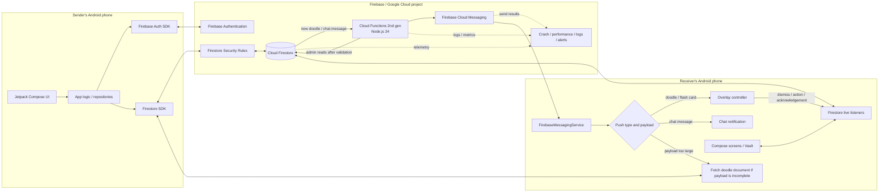
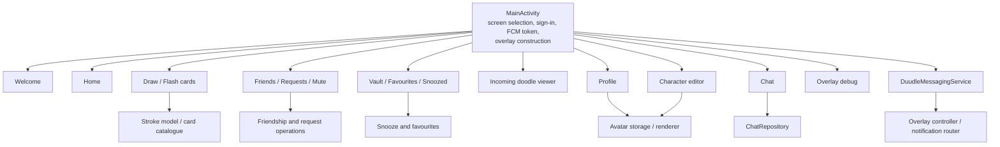
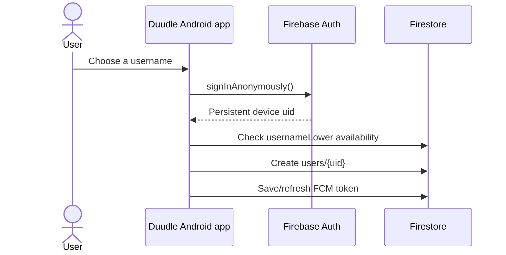
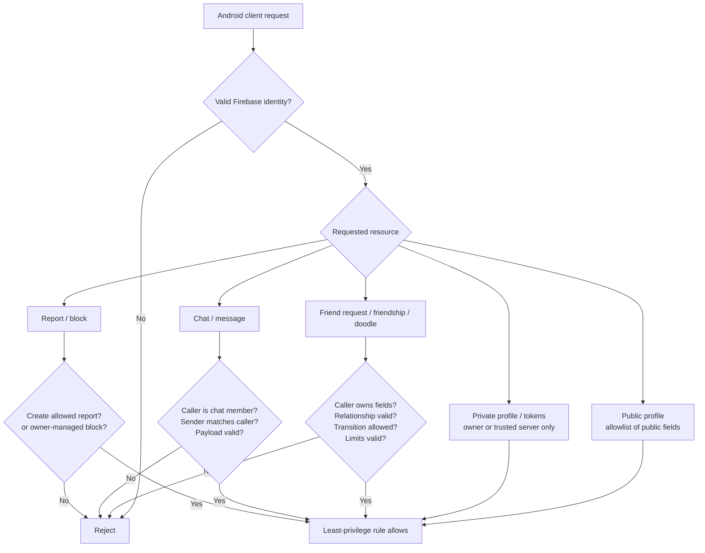
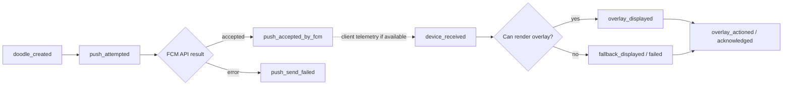
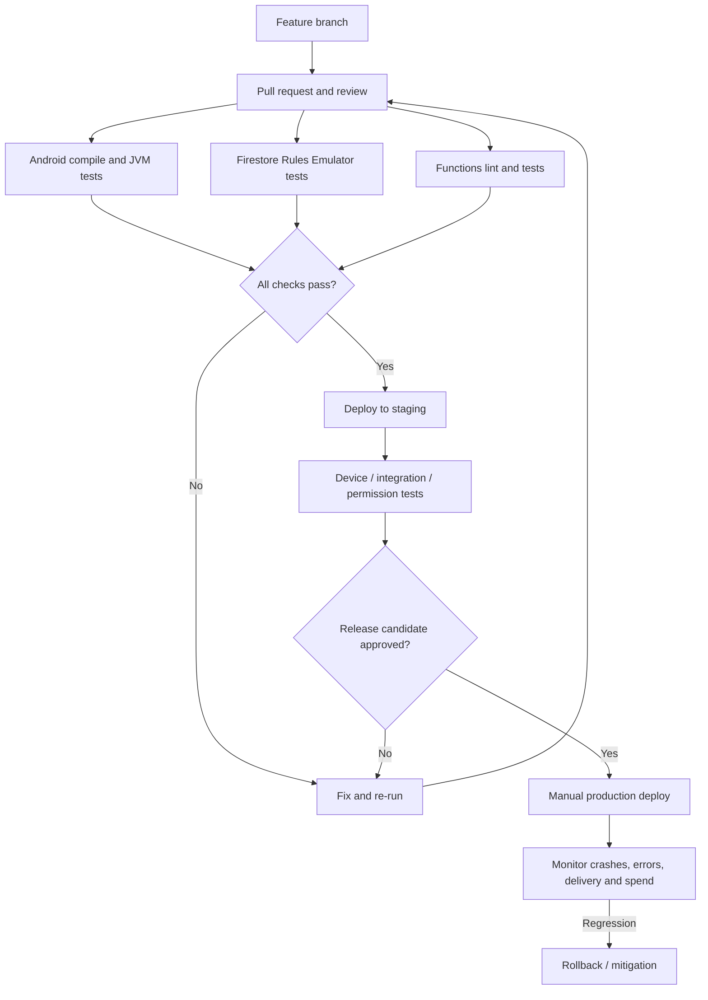

# Duudle — Architecture Flow and Production Design

> **Purpose:** One end-to-end reference for how Duudle works, how data moves through it, the current documented design, the risks identified from `README.md` and `ARCHITECTURE.md`, and the recommended production-ready direction.
>
> **Status note:** This document is based on those two project documents, not a source-code or live Firebase audit. Items labelled **Current (documented)** describe the written architecture. Items labelled **Recommended** are changes to implement or verify. Do not treat a recommendation as already shipped.

## 1. System at a glance

Duudle is an Android social app for sending hand-drawn doodles and ready-made flash cards that can appear as floating overlays on a friend's phone, alongside one-to-one chat. The current backend is serverless: Android clients use Firebase SDKs directly for authentication, database reads/writes, and live listeners. Cloud Functions respond to new database documents and ask Firebase Cloud Messaging (FCM) to deliver pushes.



### Technology currently documented

| Layer | Current documented implementation | Responsibility |
|---|---|---|
| Android client | Kotlin, Jetpack Compose, one `MainActivity`, min SDK 26, target/compile SDK 36 | UI, drawing, local state, overlay, notifications, snooze alarms |
| Identity | Firebase Anonymous Authentication | Assigns an install-local Firebase `uid` |
| Database | Cloud Firestore with `firestore.rules` | Profiles, friendships, friend requests, doodles, chats/messages, mutes and favorites |
| Event processing | Cloud Functions 2nd gen, Node.js 24, `us-central1` | Reacts to newly created doodles and chat messages |
| Push | Firebase Cloud Messaging | Sends device messages for incoming doodles/cards and chat |
| Device storage | SharedPreferences and app files | Local username/avatar cache and snoozed doodles |
| Platform APIs | `WindowManager`, `TYPE_APPLICATION_OVERLAY`, `AlarmManager`, `NotificationManager`, receivers | Overlay UI, snooze/reschedule, and notifications |

**Do not add a custom server, Kubernetes, or another database just for anticipated scale.** First close the security gaps, measure real use and costs, and then add a service only when a demonstrated requirement needs it.

## 2. Android application flow

### 2.1 Current component layout

The written architecture describes a single `MainActivity` that selects screens using a `Screen` enum and `when`, without a navigation library or ViewModels. State is held in Compose (`remember`/`rememberSaveable`) and some activity-level fields. Snapshot listeners use `DisposableEffect` and are removed when their composables leave composition.



### 2.2 Recommended evolution (incremental, not a rewrite)

1. Move screen state and business actions into `ViewModel`s so recomposition, lifecycle changes, and testability are easier to manage.
2. Introduce repositories as the single app-facing boundary around Firebase/Auth/Firestore. `ChatRepository` is already documented as an example; extend the same pattern where practical.
3. Use a navigation component and explicit destinations/back stack when this can be introduced safely; preserve working deep links/notification routing during migration.
4. Extract an `OverlayController`/manager from `MainActivity`. It should own permission checks, main-thread window creation/removal, payload validation, timeout/dismissal, and fallback behaviour. Keep the service and UI lifecycle responsibilities clear.
5. Keep pure transformations (stroke simplification, avatar format, snooze calculation, chat helper logic) unit-testable outside Compose.
6. Refactor one feature at a time, maintaining regression tests after each move. Do not couple a structural refactor to security-rule changes in one unreviewable deployment.

## 3. Identity and access-control flow

### 3.1 Current documented identity flow



The current account is anonymous and effectively tied to the installed app data. Removing the app or clearing its data can strand the account because no recovery/linking path is documented. Anonymous authentication identifies a caller; it does **not** establish that the caller owns a claimed sender/receiver field or is allowed to change a friendship.

### 3.2 Recommended identity and authorization model

- Add account linking/recovery (for example, link the anonymous Firebase user to a supported sign-in provider) without changing the current `uid`; handle collisions/credential-in-use carefully and test migration.
- Build account deletion as a controlled server-side workflow that deletes or anonymizes associated data according to a documented retention policy. Make repeat requests safe.
- Keep a minimal, queryable public profile separate from private device/credential-related data.
- **High-priority privacy review:** the documented design stores `fcmToken` on `users/{uid}` while user documents can be read by any signed-in user. If the deployed rules match the document, other authenticated users may be able to read device push tokens. Move tokens into an owner-only device/token subcollection or another private location and let trusted server code read them with Admin SDK. Revoke/rotate tokens and clean up stale ones.
- Refresh and manage multiple device tokens per account; `onNewToken` must update the right device record, and sign-out/deletion should remove or invalidate the corresponding registration.

### 3.3 Security rules: current gap and target

The architecture document explicitly records that signed-in users can write `friend_requests`, `friendships`, and `doodles` too broadly. This can allow a determined user to forge relationship or sender fields. A signed-in check alone is not sufficient.

**Target security contract**

- Deny by default; require authenticated identity for protected data and validate every path, operation, field, type, size and state transition.
- Users can update only permitted fields on their own profile. Prevent clients from setting trusted or server-owned fields such as moderation status, privileged roles, counters, timestamps that must be trusted, or device tokens made public.
- Friend requests: sender must equal `request.auth.uid`; recipient must be valid; status transitions must be constrained; duplicates and self-requests rejected; users may accept/decline only requests addressed to them.
- Friendships: created/deleted only through validated transitions, with canonical participants and no forged pairings. Consider a callable Cloud Function for multi-document relationship changes that require transaction-like authority.
- Doodles/cards: sender must be the authenticated user; validate receiver, relationship/block state, payload type/size and allowed initial state; receiver-only actions and sender-only actions must be explicit.
- Chats/messages: keep membership fixed and validated; sender must be the caller; validate message kind/length and allowed edits; keep read receipts scoped to the current member. The existing rules documented for chat membership and message creation are a useful base, but must be tested against the actual rules file.
- Mutes, favorites, blocks and private device tokens: owner-only. Do not let a client set another user's preferences.
- Reports and moderation decisions: submitter may create a report with constrained fields; only authorized moderation/admin workflows can read sensitive reports broadly or change moderation outcomes.
- Avoid trusting client-supplied timestamps or relationship facts when they affect privilege decisions.
- Write automated positive and negative tests for every collection and sensitive field using the Firebase Local Emulator Suite before deploying rules.



### 3.4 App Check and abuse resistance

- Configure Firebase App Check for Android using Play Integrity where appropriate.
- Begin in monitoring/metrics mode, verify legitimate production and test traffic, then enforce supported Firebase products in a controlled rollout.
- App Check reduces requests from unauthorized clients; it does **not** replace correct Authentication and Firestore Rules.
- Add server-side rate limits/quotas for account creation, friend requests, doodle creation, chat messages and push-triggering actions. Use server-enforced checks, timestamps/counters with abuse-resistant design, or a trusted callable endpoint where needed; client-side cooldowns alone are not security.
- Validate function input even when the data was written to Firestore by a client.
- Consider blocking/reporting signals, spam detection, abuse review and operational escalation before opening a public beta.

## 4. Database model and privacy boundaries

### 4.1 Current documented collections

| Data | Current documented location / purpose | Access expectation to verify or implement |
|---|---|---|
| Public profile | `users/{uid}`: `uid`, username fields and currently a token field | Authenticated public profile fields only; keep secrets and device tokens private |
| Friend requests | `friend_requests` with `fromUid`, `toUid`, status and timestamp | Only participants may perform the correct transition |
| Friendships | `friendships`, participant fields and creation time | Must reflect a valid accepted relationship; not freely writable |
| Doodles / flash cards | `doodles` with sender, receiver, strokes or `cardId`, status, created time | Authorized sender creation; receiver-specific reads/actions; bounded payload |
| Private preferences | `users/{uid}/mutes`, favorites subcollections | Owner only |
| Chat | deterministic `chats/{uidLow_uidHigh}` document and nested `messages` | Members only; member set cannot be manipulated by clients |
| Reports | **Recommended** moderation collection | Minimal access; protect reporter and evidence data |
| Blocks | **Recommended** owner-managed relationship/block data | Owner writes; enforce block in reads, sends, and function delivery checks |
| Device registrations | **Recommended** private per-device/token documents | Owner or trusted server only |
| Deletion jobs | **Recommended** server-controlled jobs/status | No client access to other users' jobs; operations auditable |

Do not change collection paths or push payload contracts casually: installed app versions may still consume old data. Use additive migrations, dual-read/write only when necessary, and a removal plan for obsolete fields.

### 4.2 Firestore scale and cost hygiene

- Inspect real query patterns, snapshot-listener lifetimes and indexes; remove listeners when a screen/component is no longer active.
- Paginate histories with cursors rather than loading an unbounded history. Current docs say Chat listens to the newest 50 messages—preserve bounded loading and add older-page retrieval if needed.
- Avoid hot documents and excessive writes to aggregate counters. If counters become contended, use a supported aggregation/sharded approach instead of repeatedly updating one shared document.
- Review index fanout; exempt large fields (such as stroke arrays/maps) from indexing if they are not queried by those fields.
- Track Firestore reads, writes, deletes, stored bytes and cost per active user. Set budget alerts; an alert is not an automatic hard spending cap.
- Choose database/compute regions based on observed user geography, latency, availability and cost; document the existing database location before planning a migration.
- Load-test realistic listener, friend-request and doodle/chat traffic. Scaling capacity should be established by measurement, not guessed from a unit-test count.

## 5. End-to-end feature flows

### 5.1 Doodle or flash-card send and overlay

```mermaid
sequenceDiagram
  participant S as Sender app
  participant R as Firestore Rules
  participant DB as Firestore
  participant CF as onDoodleCreated
  participant FCM as FCM
  participant M as Receiver messaging service
  participant O as Overlay controller
  participant V as Receiver Vault / Firestore listener
  S->>R: Create doodle with sender, receiver and content
  R->>R: Check identity, relationship, block, size and allowed fields
  R->>DB: Commit valid document
  DB-->>CF: Document-created event
  CF->>DB: Read receiver profile, private device tokens, mute/block/relationship state
  CF->>CF: Validate event; enforce limits; deduplicate processing
  alt Receiver blocked sender / muted sender / no valid token
    CF-->>CF: Skip or record controlled delivery outcome
  else Eligible recipient
    CF->>FCM: Send new_doodle with ID and compact payload
    FCM-->>M: Delivery attempt to device
    alt Payload contains supported content
      M->>O: Validate payload and request overlay
    else Content not in payload / fetch required
      M->>DB: Fetch doodles/{id} asynchronously with timeout/error handling
      DB-->>M: Doodle content if still authorized/available
      M->>O: Request overlay
    end
    O->>O: Check overlay permission, app/device state and safe dismissal
    alt Overlay permitted and rendered
      O->>V: Record display/interaction outcome (minimal telemetry)
    else Overlay unavailable
      O->>M: Use an approved fallback (for example, notification or in-app inbox)
    end
  end
  O->>DB: Dismiss / remove / draw reply updates authorized status
  O->>O: Snooze is saved locally and re-armed with AlarmManager
```

Important distinctions:

- A successful FCM send call confirms that FCM accepted a send request; it does **not** prove the phone received it, displayed the overlay or was seen by the user.
- An overlay may fail because of permissions, OS restrictions, battery management, process state or OEM behaviour. Always handle denial/failure gracefully, expose clear settings and provide a non-overlay path to the item.
- Validate every FCM payload as untrusted input. Check required fields, lengths, allowed IDs and content format. Do not assume a push is authoritative state; the Firestore document and rules remain the source of truth.
- Use a stable `doodleId` / event identifier through processing so the same logical event cannot create duplicate overlays or duplicate analytics events.
- If a payload is too large, fetch asynchronously with timeouts and explicit failure handling. Do not make a potentially long blocking network fetch in a critical messaging callback without a safe bound.

### 5.2 Chat flow

```mermaid
sequenceDiagram
  participant A as Sender app
  participant DB as Firestore / Rules
  participant B as Receiver app
  participant CF as onChatMessageCreated
  participant FCM as FCM
  A->>DB: Batch/create message and update chat preview
  DB-->>A: Local/confirmed state; pending state resolves
  DB-->>B: Live listener updates if chat is active
  DB-->>CF: New message event
  CF->>DB: Recheck chat membership, friendship, block/mute and recipient tokens
  alt Not eligible or no valid token
    CF-->>CF: Skip notification; message remains subject to chat access rules
  else Eligible
    CF->>FCM: Send compact chat_message payload
    FCM-->>B: Delivery attempt
    B->>B: Suppress duplicate or current-open-chat notification if appropriate
  end
  B->>DB: Update only own lastRead entry
```

Requirements: enforce membership and sender identity in rules, validate message length/type server-side for push processing, make message creation/preview updates consistent, handle offline pending writes, and avoid logging chat text in analytics or routine logs.

### 5.3 Snooze flow (local)

The documented design saves a snoozed doodle in `files/snoozed/{doodleId}.json`, records a trigger time and schedules an `AlarmManager` alarm. Receivers reschedule after reboot/update/permission changes; the Vault can cancel the alarm and file.

Recommended safeguards: validate the local serialized data before rendering; ensure cancellation, snooze and remove actions are idempotent; handle exact-alarm permission denial and inexact timing; test process death, reboot, app update, Android 8–16 behaviours and multiple OEMs. Snooze is a local-device state unless an explicit synced snooze model is added later.

### 5.4 Live screens and listener lifecycle

The documented app uses Firestore snapshot listeners rather than polling. Listed listeners include Home (unseen received doodles), Friends (friendships, requests, mutes, chat unread state), Vault (sent/received doodles and favorites), and Chat (newest 50 messages and chat metadata).

For each listener: identify its owner/lifecycle; close it when no longer needed; expose loading/empty/error/offline states; constrain result sets; handle permission-denied errors explicitly; avoid starting duplicate listeners during recomposition; monitor reads and active listener counts.

## 6. Overlay, notification, and Android platform constraints

`WindowManager` with `TYPE_APPLICATION_OVERLAY` requires special “Display over other apps” permission and can behave differently by OS/OEM. This is a prominent user-permission and reliability boundary.

- Explain the value of the overlay before opening system settings; request only when the user chooses to enable it.
- Provide a visible in-app toggle and a clear way to dismiss/disable overlays at any time.
- Keep overlay controls obvious, small and dismissible; do not block essential controls, impersonate system UI, trick users into taps, or create deceptive/disruptive ad behaviour.
- If the permission is absent/revoked, show a meaningful in-app/notification fallback and do not crash or repeatedly nag.
- Validate and test tap targets, accessibility, screen readers, rotation, multi-window, lock-screen behaviour, notification permission, battery optimization, Doze and manufacturer-specific background limits.
- Keep all `WindowManager` operations on the main thread; reliably remove overlays on dismissal/error and avoid leaking a window/context.
- Review manifest permissions, exported activities/receivers/services, notification channels, PendingIntent mutability/immutability and intent extras. The documented activity is exported and validates incoming UIDs; test deep-link/notification intent spoofing against actual implementation.

An overlay permission by itself does not guarantee Play approval. The implementation, disclosure, user control and behaviour need to comply with Android and Play policy.

## 7. Content safety, moderation, and user controls

Doodles, usernames, characters, and chat are user-generated content or user interactions. The current docs mention mute, but mute is not equivalent to blocking and does not provide a complete moderation lifecycle.

Recommended minimum before public distribution:

1. Present Terms of Use / user policy and require acceptance before a user can create or upload content.
2. Publish an accessible policy describing prohibited content and consequences.
3. Implement in-app reporting for both a user and relevant content/message, with a reason, content/user reference, timestamp and optional context. Avoid collecting more evidence than needed.
4. Implement a true block function for one-to-one interactions. Enforce blocks in sending, discovery, chat access and Cloud Function push eligibility; do not only hide a profile in the UI.
5. Provide an internal moderation workflow, record review outcomes, make repeat reporters/abuse manageable, and respond to reports in a timely and documented manner.
6. Apply accurate content rating and age-screening/eligibility as appropriate to the app's audience and the current Play Families/content policies. Do not assume a social drawing app is exempt from UGC requirements.
7. Have a process for urgent reports, harassment/bullying, account suspension, appeal/review and repeat offenders.

Official policy: [Google Play — User Generated Content](https://support.google.com/googleplay/android-developer/answer/9876937).

## 8. Account lifecycle and data deletion

### Account linking / recovery

- Support recovery or linking without accidentally replacing the user's UID and losing their friendships/doodles.
- Handle interrupted linking, account collisions and existing credential conflicts.
- Make the limitations of anonymous-only accounts clear until recovery exists.

### Delete account and associated data

If account creation is available, Google Play requires an intuitive in-app account-deletion path and a functional web resource to request deletion without reinstalling the app. Complete the Play Console Data safety data-deletion questions and disclose any permitted retention.

The deletion workflow must enumerate and safely process: profile/public identifiers, private device tokens, friend requests, friendships, doodles sent/received, chat membership/messages according to the designed deletion policy, favorites, mutes, blocks, reports where retention is justified, local cached content, and pending background jobs. Decide whether other users' conversation copies are deleted, anonymized, or retained and document that behaviour. Be transparent about legally or security-required retention; do not promise that absolutely every trace is erased if a documented exception applies.

Suggested flow: authenticated request + re-authentication/confirmation where appropriate → create server-controlled deletion job → prevent new writes/notifications → delete/revoke tokens → remove or anonymize related records in bounded, retryable batches → delete Auth account when safe → record completion status without retaining unnecessary personal data → notify user. Make it idempotent, observable and support retry/partial failure.

Official policy: [Google Play — Account deletion requirements](https://support.google.com/googleplay/android-developer/answer/13327111).

## 9. Observability and analytics

Product analytics and operational observability answer different questions. Use both, with data minimization.

### 9.1 Product/usage metrics

- New accounts and onboarding completion.
- Daily/weekly/monthly active users, with a documented definition.
- Friend requests sent/accepted/declined, and time to accept.
- Doodles/cards sent, viewed/acted on, and replies sent.
- Chat messages sent and active conversations (count metrics, not message text).
- Overlay permission acceptance and fallback usage.
- Report/block volumes and moderation response time.

### 9.2 Reliability/delivery metrics

- Crash-free users/sessions, ANRs and non-fatal exceptions.
- Startup and key interaction latency; overlay creation success/failure.
- Firestore permission errors, read/write volume, listener failures and query latency.
- Cloud Function invocation count, duration, errors, duplicate processing, and retry/dead-letter outcomes where used.
- FCM send accepted/failed counts, invalid/unregistered tokens, client receipt, overlay render, fallback shown, and user interaction—measured as separate events.
- Spend and resource usage by service, cost per active user, and alerts for unexpected changes.

### 9.3 Event lifecycle



Use unique event IDs/doodle IDs and idempotent event handling. A device receipt/render acknowledgement may be delayed or never arrive while the device is offline, notification permission is denied, or the app is force-stopped; do not label a send success as “seen”. Decide which events are essential and sample or aggregate noncritical events to avoid excess Firestore writes/costs.

### 9.4 Privacy-safe telemetry

- Never place full chat text, private doodle strokes, raw FCM tokens, auth tokens, email credentials, or sensitive identifiers in analytics or normal logs.
- Prefer event IDs and pseudonymous/hashed identifiers where practical; restrict logging access and define retention.
- Do not send sensitive content to third-party analytics by default. Disclose the SDKs/data collected in the privacy policy and Google Play Data safety form accurately.
- Build alerts and an on-call/owner response plan for crashes, function failures, unusual traffic, and cost spikes.

Recommended tooling: Firebase Crashlytics (crashes/non-fatal/ANRs), Firebase Performance Monitoring (app performance), Cloud Logging/Monitoring (functions/backend and alerting), Firebase Analytics (product events only where justified), and BigQuery export if data volumes/analysis needs warrant it.

Official docs: [Crashlytics for Android](https://firebase.google.com/docs/crashlytics/android/get-started), [Performance Monitoring for Android](https://firebase.google.com/docs/perf-mon/get-started-android), [App Check](https://firebase.google.com/docs/app-check), [Firestore best practices](https://firebase.google.com/docs/firestore/best-practices).

## 10. Cloud Functions: correctness and scaling

Currently documented triggers are `onDoodleCreated` on `doodles/{id}` and `onChatMessageCreated` on `chats/{chatId}/messages/{id}`. Functions use Admin SDK reads and send FCM data messages.

Recommended controls:

- Treat every trigger payload as untrusted; validate field types, size and current relationship/block/mute state before sending.
- Design work to be safely repeatable. Use the source document/event ID as a deduplication key when appropriate, and avoid duplicate pushes if an event is reprocessed.
- Use bounded timeouts, retry/backoff where appropriate, and explicit handling for invalid/expired tokens. Make sure a failed delivery does not corrupt the underlying doodle/chat record.
- Keep function work small and asynchronous; move long or rate-limited work to Cloud Tasks only if measured need justifies it.
- Track successful sends separately from client delivery/display outcomes. FCM tokens can expire or be replaced.
- Use per-recipient/per-user limits and abuse controls for push-triggering operations.
- Test trigger logic for deleted users, missing tokens, blocked/muted pairs, nonexistent documents, malformed payloads, duplicate invocation and FCM errors.
- Keep Admin SDK credentials server-side and never put privileged service account keys in the Android app or repository.

## 11. Environments, tests, releases, and rollback

### 11.1 Current documented deployment risk

The architecture says there is one Firebase project (`duudle-296a9`) and no staging environment, so deploying rules/functions affects the live project. The README reports 110 JVM unit tests and a Samsung Galaxy A34 checklist. These are useful, but they do not establish production security, load capacity or complete device compatibility.

### 11.2 Recommended environment design

- Separate development/staging and production Firebase projects, with explicit project selection in build/deploy commands.
- Keep production credentials/secrets out of source control and CI logs. Do not commit `.env`-style secrets, service accounts or test-user data.
- Confirm Firestore and Storage rules (if Storage is introduced), indexes, function config and Firebase App Check settings are version-controlled and reviewed.
- Add CI gates for Android compile/unit tests, `firestore.rules` emulator tests, Cloud Functions tests/lint, and a release artifact build.
- Smoke-test staging on physical Android devices before production.
- Require manual production approval, capture the deployed version/config, monitor the rollout and keep a rollback plan. Rules rollbacks are versioned too; a previous rule set must not re-open the known broad write gaps.

### 11.3 Suggested release pipeline



### 11.4 Recovery readiness

- Decide what data must be backed up and how Firestore exports are secured, retained and restored.
- Perform a test restore into a non-production project; a backup that was never restored is not a proven recovery plan.
- Document who can deploy, who can access production data, how to rotate credentials, and how to respond to suspected abuse or data exposure.

## 12. Scale strategy

Scale progressively using measurements and service-native capabilities:

1. Tighten authorization, add moderation and rate limits, instrument baseline usage and costs.
2. Optimize Firestore query/listener scope, indexes, pagination, document sizes and function work.
3. Load-test expected bursts and establish error/latency/cost budgets for a small beta.
4. Use Cloud Tasks for throttled/retryable background work if a trigger cannot safely finish within normal function bounds.
5. Use BigQuery or another analytical store for large-scale aggregate/event analysis rather than querying operational Firestore history as an analytics warehouse.
6. Use Cloud Storage if larger image/media objects are introduced; do not put large binary files in Firestore documents.
7. Add a custom service only when a specific need—such as complex search, high-volume queues, multi-provider integration, or measured latency/cost bottlenecks—cannot be addressed cleanly by Firebase.

## 13. Implementation ownership map

| Area | Likely files/resources to inspect or change | Completion evidence |
|---|---|---|
| Authorization | `firestore.rules`, `firebase.json`, rule tests | Emulator negative/positive tests pass; no broad writes on sensitive collections |
| Push privacy | `users/{uid}` schema, `MainActivity.kt`, `DuudleMessagingService.kt`, `functions` | Tokens are private per device; no token readable through public profile queries |
| Function reliability | Cloud Functions source and tests | Validation, block/mute checks, dedupe and token cleanup tests pass |
| Account recovery/deletion | Auth UI/service, profile/settings, deletion callable/job and web deletion page | Linked-account recovery and full deletion flow verified end-to-end |
| UGC controls | Friends/chat/doodle UI, moderation collections/services | Policy acceptance, report and block flows work and are enforced server-side |
| Overlay safety | Manifest, overlay manager (currently documented in `MainActivity.kt`), messaging service | Permission denial/revoke, fallback, dismissal and device matrix tests pass |
| Monitoring | Gradle/Firebase config, Cloud Logging/Monitoring | Test crash/perf event and alert observed; runbook owner assigned |
| CI/environments | Gradle, Firebase CLI config, workflows | CI is green; staging deploy verified; production gate/rollback documented |
| Store readiness | Release bundle, Play Console, privacy policy and listing | Target SDK, forms, deletion link, content rating and asset rights verified |

## 14. Related documents

- [`README.md`](README.md) — product behaviour, feature status and quick-start facts.
- [`roadmap.md`](roadmap.md) — prioritized implementation and Play Store launch checklist.
- `firestore.rules` — actual access-control source of truth (inspect it; this document is not a substitute).
- `PHONE_TEST_CHECKLIST.md` — device-level verification described by the project docs.

---

**Final caveat:** This document is a target architecture and flow reference. Before declaring Duudle secure or Play-ready, inspect the real Kotlin source, manifest, Gradle target SDK, `firestore.rules`, Cloud Functions source, Firebase console configuration, and Play Console forms; run the tests and retain their results.
